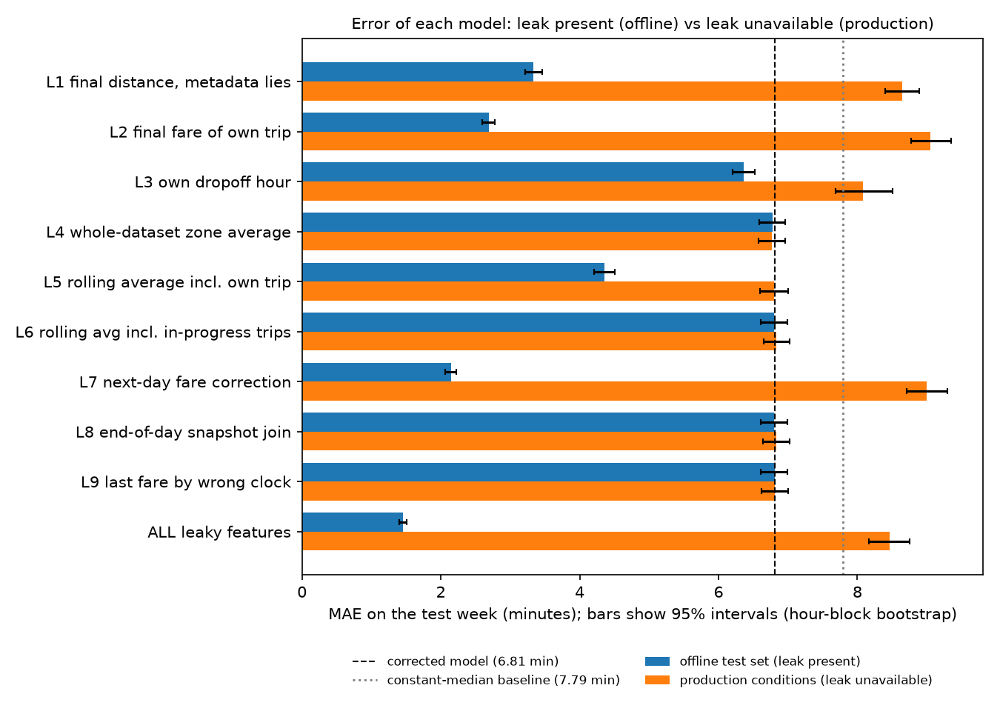
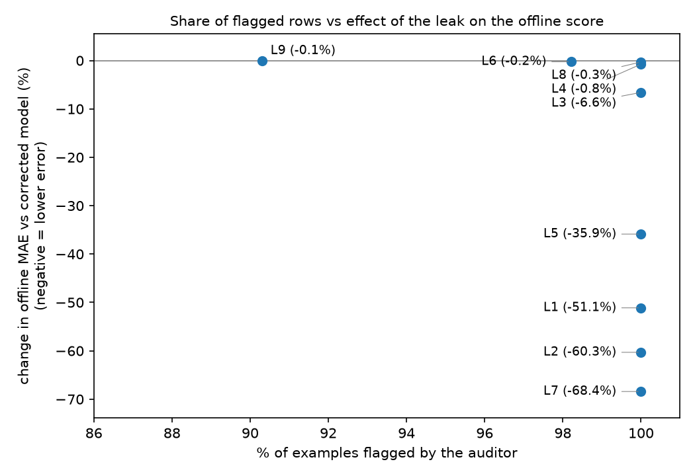

# LeakScope

**Auditing what information was actually available at prediction time.**

[](https://github.com/0utc/leakscope/actions/workflows/ci.yml)


LeakScope is a temporal data-leakage auditor for ML pipelines. Every feature declares *when the event happened* and *when the value became usable*. LeakScope checks those declarations against the prediction time, then measures what the leaks do to a model's score.

The worked example predicts NYC yellow-taxi trip duration at pickup time (January 2024, 100,000 prediction examples).



*MAE on the test week with 95% intervals. Offline, the leaky models look far better than the honest one. When the leaked value is not available at serving time, several of them become worse than the honest model.*

## Main results

| | Result |
|---|---|
| Audit | 10 of 10 leaky features flagged, 9 of 9 valid features left alone |
| Honest model | MAE 6.817 min (constant-median baseline: 7.787) |
| All leaks, offline | MAE 1.451 min, **-78.7%** vs the honest model |
| Same model, leaks unavailable | MAE 8.471 min, **+24.3%** vs the honest model |
| Float-noise jitter | MAE moves by up to 0.066 min when features change at the 1e-13 level; quote the honest model as 6.817 min (SD 0.007) |

Two findings that surprised me while building it:

- **The share of rows flagged does not predict the damage.** Seven leaky features are flagged on 100% of rows, yet their effect on offline MAE ranges from almost nothing to -68%. A score-based check would miss the harmless-looking ones; an availability audit does not.
- **Low correlation does not mean safe.** The dropoff hour has a correlation of about 0.001 with the target, yet it lowers MAE by 6.5% when combined with pickup hour.

The full report, with intervals, ablations and every finding, is in [`results/report.md`](results/report.md).

## How it works

Each feature in [`configs/features.yaml`](configs/features.yaml) declares its source, its event clock, its availability clock and, for aggregates, exactly which rows it covers. Four rules are evaluated per example:

| Rule | Fires when |
|---|---|
| R1 | the feature's event time is after the prediction time |
| R2 | the feature's availability time is after the prediction time |
| R3 | the feature is declared to be known only after the outcome |
| R4 | an aggregate uses source rows that are not yet available (including the example's own row) |

A value available at exactly the prediction time is valid; one second later is not. A conformance check recomputes stored aggregates by brute force and compares them with their declared definition, which catches a declaration that lies about its own window.

The auditor is scored on 15 labelled scenarios: 10 leaky (L1 to L10) and 5 negative controls (N1 to N5). See [`docs/scope.md`](docs/scope.md) for the full table.

```
scen  what it tests                          feature                        expected    fired       ok  rows flagged
L1    final distance, metadata lies          leak_trip_distance             R3          R3          yes 100000/100000
L2    final fare of own trip                 leak_total_amount              R1,R2       R1,R2       yes 100000/100000
L4    whole-dataset zone average             leak_zone_avg_global           R4          R4          yes 100000/100000
L6    rolling avg incl. in-progress trips    leak_zone_avg_60m_inprogress   R4          R4          yes  98211/100000
L9    last fare by wrong clock               leak_last_fare_zone            R2          R2          yes  90309/100000
N5    60-minute availability window          zone_avg_dur_60m               -           -           yes      0/100000
...
19 features evaluated (10 leaky, 9 valid); exact rule-set match: 19/19
```

*(Excerpt. The complete scorecard is in the report.)*


*Each point is one leaky feature: share of examples flagged (horizontal) against the change in offline MAE vs the honest model (vertical). The four points near zero (L4, L6, L8, L9) change MAE by 0.05 min or less, which is below the 0.066 min float-level jitter measured in the report, so their order is not meaningful.*

## Quick start

```bash
git clone https://github.com/0utc/leakscope.git
cd leakscope
python -m venv .venv
# Windows: .venv\Scripts\activate    Linux/macOS: source .venv/bin/activate
pip install -e ".[dev]"

python -m leakscope demo
```

The demo needs no download. It generates synthetic taxi data with the NYC TLC schema, then runs the whole workflow (pipeline, audit, ML comparison, report) into `demo_work/` and `demo_results/`. Your real database and results are never touched. Open `demo_results/report.md` when it finishes.

Synthetic data is not real: it has plausible structure, not real traffic. Use the demo to see the workflow, and the real data for the numbers above.

## Data

For the real run, download the January 2024 yellow-taxi trip file and the zone lookup from the [NYC TLC trip-record page](https://www.nyc.gov/site/tlc/about/tlc-trip-record-data.page) and place them at:

```
data/raw/yellow_tripdata_2024-01.parquet
data/raw/taxi_zone_lookup.csv
```

Paths and every setting are in [`configs/taxi.yaml`](configs/taxi.yaml). The raw file has **no trip ID and no availability timestamps**: IDs are created at ingestion, and availability times are **simulated** from configurable lags (see Limitations). [`docs/data_dictionary.md`](docs/data_dictionary.md) classifies every column as known-at-pickup or post-outcome.

## Commands

Run from the project root.

| Command | What it does |
|---|---|
| `python -m leakscope demo` | Synthetic data, pipeline, audit, ML comparison and report in one go |
| `python -m leakscope synthetic` | Write the synthetic data only |
| `python -m leakscope pipeline` | Build the DuckDB database from the raw data in the config |
| `python -m leakscope audit` | Audit the feature registry; exits with code 1 if a scenario is mis-detected |
| `python -m leakscope experiment` | Leaky vs corrected models, bootstrap intervals, production conditions, ablations |
| `python -m leakscope sensitivity` | How far scores move under float-level noise in the features |
| `python -m leakscope benchmark` | Runtime and peak memory at several sizes (median of repeated runs) |
| `python -m leakscope report` | Build `results/report.md`, `results/audit_report.json` and the figures |

Reproducing the real-data results, in order:

```bash
python -m leakscope pipeline
python -m leakscope audit
python -m leakscope experiment
python -m leakscope sensitivity
python -m leakscope benchmark
python -m leakscope report
```

Tests: `pytest -q`. Tests that need the real database skip themselves when it is absent, which is why CI (no real data) skips nine of them.

## Performance

Synthetic data, 3 runs per size, each in a fresh Python process, median shown. Hardware: Lenovo IdeaPad 1 14ADA05, AMD 3020e (2 cores), 4 GB RAM, Windows 11 Pro; DuckDB limited to 1 GB and 2 threads.

| Examples | Total time | Peak memory |
|---|---|---|
| 10,000 | 24.7 s | 226 MiB |
| 50,000 | 38.2 s | 264 MiB |
| 200,000 | 85.7 s | 434 MiB |

The ML stage is 85% to 89% of the total time. Details and limits are in section 4 of the report.

## Limitations

Please read these before quoting any number.

- **Availability times are simulated** from configurable lags, not observed. Results such as the share of rows flagged for L9 depend on them (at a fare lag of 0, L9 would flag nothing).
- **The scenarios and the auditor were designed together.** A perfect score shows the implementation matches its specification, not that all leakage is caught. The auditor reports explicit rule violations only.
- **R4 supports duration aggregates grouped by zone.** Other aggregates raise `NotImplementedError`.
- **One month, one chronological split (last 7 days), one model class** (HistGradientBoostingRegressor). Trips of 1 to 180 minutes only.
- **Three sources of uncertainty.** The bootstrap intervals cover test-set sampling only. Float-level feature noise was measured separately (offline scores only). Other splits, months, model seeds and real availability lags were **not studied**.
- **Production conditions are a simulation**, with serving values chosen by me.

## Repository layout

```
configs/    taxi.yaml (settings), features.yaml (feature registry)
src/leakscope/
  ingestion.py, temporal_model.py      cleaning, simulated availability times, examples
  feature_builder.py, temporal_join.py point-in-time features
  scenarios.py                         labelled leaky and valid scenarios
  auditor.py, conformance.py           rules R1-R4 and the conformance check
  audit_scoring.py                     precision/recall against the labels
  evaluation.py, analysis.py           ML comparison, bootstrap, production, ablations
  sensitivity.py, benchmark.py         float-noise study, runtime and memory
  reporting.py, cli.py                 report generation and command line
tests/      unit, integration and end-to-end tests
docs/       scope.md, data_dictionary.md, devlog.md, progress.md
results/    report.md and the CSV/JSON results behind it
```

## Documentation

- [`docs/scope.md`](docs/scope.md): task, definitions, rules, labelled scenarios
- [`docs/devlog.md`](docs/devlog.md): lab notebook, including defects found and claims later corrected
- [`docs/progress.md`](docs/progress.md): what is done and what is not
- [`results/report.md`](results/report.md): the generated audit and experiment report

## License

Code: [MIT](LICENSE). The NYC TLC trip data is public data under its own terms and is not included in this repository.