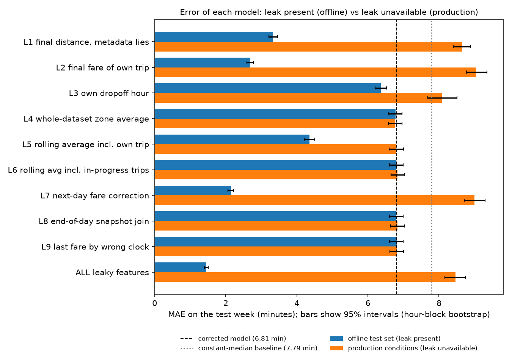
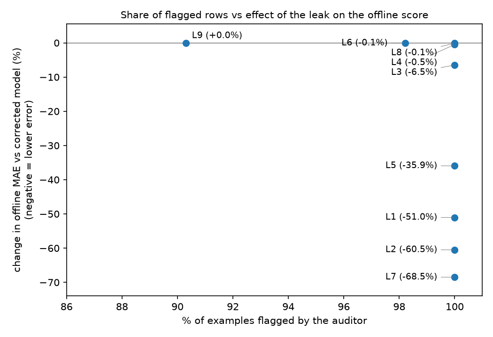

# LeakScope report

*Generated by `python -m leakscope.reporting` from the database and the files in `results/`. No timestamps are embedded, so this file only changes when the results change.*

## Summary

- **Audit:** 10 of 10 leaky features were flagged and 9 of 9 valid features were left alone (feature level: precision 1.000, recall 1.000; rule level: precision 1.000, recall 1.000). The scenarios were designed together with the auditor, so this shows that the implementation matches its specification, not that all leakage is caught (see section 3).
- **Honest model:** MAE 6.809 min on the test week, against 7.787 for a constant-median baseline.
- **Offline vs production:** with all leaky features the offline MAE is 1.451 min (-78.7% vs the honest model). When the leaked values are not available at prediction time the same model scores 8.461 min (+24.3% vs the honest model).



*Bars: MAE on the test week with 95% intervals (hour-block bootstrap). Dashed line: the corrected model. Dotted line: the constant-median baseline. The lines are single values without intervals, and the bar intervals describe each model on its own: to compare two models use the paired differences in the tables below, which are tighter than overlapping bars suggest.*

## 1. Audit scorecard

| Scenario | What it tests | Feature | Expected rules | Fired rules | OK | Rows flagged |
|---|---|---|---|---|---|---|
| L1 | final distance, metadata lies | `leak_trip_distance` | R3 | R3 | yes | 100,000 / 100,000 |
| L2 | final fare of own trip | `leak_total_amount` | R1, R2 | R1, R2 | yes | 100,000 / 100,000 |
| L3 | own dropoff hour | `leak_dropoff_hour` | R1, R2, R3 | R1, R2, R3 | yes | 100,000 / 100,000 |
| L4 | whole-dataset zone average | `leak_zone_avg_global` | R4 | R4 | yes | 100,000 / 100,000 |
| L5 | rolling average incl. own trip | `leak_zone_avg_60m_self` | R4 | R4 | yes | 100,000 / 100,000 |
| L6 | rolling avg incl. in-progress trips | `leak_zone_avg_60m_inprogress` | R4 | R4 | yes | 98,211 / 100,000 |
| L7 | next-day fare correction | `leak_fare_correction` | R1, R2 | R1, R2 | yes | 100,000 / 100,000 |
| L8 | end-of-day snapshot join | `leak_snapshot_zone_avg` | R1, R2 | R1, R2 | yes | 100,000 / 100,000 |
| L9 | last fare by wrong clock | `leak_last_fare_zone` | R2 | R2 | yes | 90,309 / 100,000 |
| L10 | available 1 second too late | `boundary_late` | R2 | R2 | yes | 3 / 3 |
| N1 | pickup-time fields | `pickup_hour` | - | - | yes | 0 / 100,000 |
| N1 | pickup-time fields | `pickup_dow` | - | - | yes | 0 / 100,000 |
| N1 | pickup-time fields | `pu_zone` | - | - | yes | 0 / 100,000 |
| N1 | pickup-time fields | `passenger_count_filled` | - | - | yes | 0 / 100,000 |
| N1 | pickup-time fields | `passenger_missing` | - | - | yes | 0 / 100,000 |
| N2 | zone avg available by t_pred | `zone_avg_dur_asof` | - | - | yes | 0 / 100,000 |
| N3 | 7-day lookback average | `zone_avg_dur_7d` | - | - | yes | 0 / 100,000 |
| N4 | available at exactly t_pred | `boundary_exact` | - | - | yes | 0 / 3 |
| N5 | 60-minute availability window | `zone_avg_dur_60m` | - | - | yes | 0 / 100,000 |

19 features evaluated (10 leaky, 9 valid); exact rule-set match: 19/19.

| Level | TP | FP | FN | TN | Precision | Recall |
|---|---|---|---|---|---|---|
| Feature | 10 | 0 | 0 | 9 | 1.000 | 1.000 |
| Rule | 15 | 0 | 0 | 61 | 1.000 | 1.000 |

### Findings

- **[R3] `leak_trip_distance`** (L1): 'leak_trip_distance' is declared to be known only after the outcome, so it can never be used for a prediction, whatever its timestamps say. Affects all 100000 examples. First affected trip IDs: 581623, 581631, 581655, 581662, 581723.
- **[R1] `leak_total_amount`** (L2): 'leak_total_amount' describes something that happens at event_dropoff, after the prediction time, for 100000 of 100000 examples (100.0%). Example: trip 581623 is predicted at 2024-01-08 00:37:16 but the value is tied to 2024-01-08 01:01:07 (23.9 min later). First affected trip IDs: 581623, 581631, 581655, 581662, 581723.
- **[R2] `leak_total_amount`** (L2): 'leak_total_amount' only becomes available at avail_fare, after the prediction time, for 100000 of 100000 examples (100.0%). Example: trip 581623 is predicted at 2024-01-08 00:37:16 but the value is tied to 2024-01-08 01:03:07 (25.9 min later). First affected trip IDs: 581623, 581631, 581655, 581662, 581723.
- **[R1] `leak_dropoff_hour`** (L3): 'leak_dropoff_hour' describes something that happens at event_dropoff, after the prediction time, for 100000 of 100000 examples (100.0%). Example: trip 581623 is predicted at 2024-01-08 00:37:16 but the value is tied to 2024-01-08 01:01:07 (23.9 min later). First affected trip IDs: 581623, 581631, 581655, 581662, 581723.
- **[R2] `leak_dropoff_hour`** (L3): 'leak_dropoff_hour' only becomes available at avail_dropoff, after the prediction time, for 100000 of 100000 examples (100.0%). Example: trip 581623 is predicted at 2024-01-08 00:37:16 but the value is tied to 2024-01-08 01:01:07 (23.9 min later). First affected trip IDs: 581623, 581631, 581655, 581662, 581723.
- **[R3] `leak_dropoff_hour`** (L3): 'leak_dropoff_hour' is declared to be known only after the outcome, so it can never be used for a prediction, whatever its timestamps say. Affects all 100000 examples. First affected trip IDs: 581623, 581631, 581655, 581662, 581723.
- **[R4] `leak_zone_avg_global`** (L4): 'leak_zone_avg_global' aggregates over source trips that were not yet available at prediction time, for 100000 of 100000 examples (100.0%): its window is the whole dataset, so it includes trips that happen after the prediction time; it includes the example's own trip. On average 31509.3 unavailable source trips per affected example (max 117471). Example: trip 581623 is predicted at 2024-01-08 00:37:16 and its aggregate uses 69138 unavailable source trip(s). First affected trip IDs: 581623, 581631, 581655, 581662, 581723.
- **[R4] `leak_zone_avg_60m_self`** (L5): 'leak_zone_avg_60m_self' aggregates over source trips that were not yet available at prediction time, for 100000 of 100000 examples (100.0%): it includes the example's own trip. On average 1.0 unavailable source trips per affected example (max 1). Example: trip 581623 is predicted at 2024-01-08 00:37:16 and its aggregate uses 1 unavailable source trip(s). First affected trip IDs: 581623, 581631, 581655, 581662, 581723.
- **[R4] `leak_zone_avg_60m_inprogress`** (L6): 'leak_zone_avg_60m_inprogress' aggregates over source trips that were not yet available at prediction time, for 98211 of 100000 examples (98.2%): its window is defined on pickup time, so it includes trips still in progress at the prediction time. On average 44.4 unavailable source trips per affected example (max 366). Example: trip 581623 is predicted at 2024-01-08 00:37:16 and its aggregate uses 18 unavailable source trip(s). First affected trip IDs: 581623, 581631, 581655, 581662, 581739.
- **[R1] `leak_fare_correction`** (L7): 'leak_fare_correction' describes something that happens at event_dropoff, after the prediction time, for 100000 of 100000 examples (100.0%). Example: trip 581623 is predicted at 2024-01-08 00:37:16 but the value is tied to 2024-01-08 01:01:07 (23.9 min later). First affected trip IDs: 581623, 581631, 581655, 581662, 581723.
- **[R2] `leak_fare_correction`** (L7): 'leak_fare_correction' only becomes available at avail_fare_correction, after the prediction time, for 100000 of 100000 examples (100.0%). Example: trip 581623 is predicted at 2024-01-08 00:37:16 but the value is tied to 2024-01-09 06:00:00 (1762.7 min later). First affected trip IDs: 581623, 581631, 581655, 581662, 581723.
- **[R1] `leak_snapshot_zone_avg`** (L8): 'leak_snapshot_zone_avg' describes something that happens at event_snapshot_eod, after the prediction time, for 100000 of 100000 examples (100.0%). Example: trip 581623 is predicted at 2024-01-08 00:37:16 but the value is tied to 2024-01-09 00:00:00 (1402.7 min later). First affected trip IDs: 581623, 581631, 581655, 581662, 581723.
- **[R2] `leak_snapshot_zone_avg`** (L8): 'leak_snapshot_zone_avg' only becomes available at avail_snapshot_eod, after the prediction time, for 100000 of 100000 examples (100.0%). Example: trip 581623 is predicted at 2024-01-08 00:37:16 but the value is tied to 2024-01-09 00:00:00 (1402.7 min later). First affected trip IDs: 581623, 581631, 581655, 581662, 581723.
- **[R2] `leak_last_fare_zone`** (L9): 'leak_last_fare_zone' only becomes available at avail_fare, after the prediction time, for 90309 of 99998 examples (90.3%). Example: trip 581623 is predicted at 2024-01-08 00:37:16 but the value (source trip 582073) is tied to 2024-01-08 00:38:42 (1.4 min later). First affected trip IDs: 581623, 581655, 581662, 581723, 581739.
- **[R2] `boundary_late`** (L10): 'boundary_late' only becomes available at avail_fare, after the prediction time, for 3 of 3 examples (100.0%). Example: trip 1 is predicted at 2024-01-10 10:00:00 but the value (source trip 101) is tied to 2024-01-10 10:00:01 (1 s later). First affected trip IDs: 1, 2, 3.

### Conformance and a known limitation

Stored aggregate values were recomputed from their declared definitions (30 examples each):

| Feature | Mismatches |
|---|---|
| `zone_avg_dur_asof` | 0 |
| `zone_avg_dur_7d` | 0 |
| `leak_zone_avg_global` | 0 |
| `zone_avg_dur_60m` | 0 |
| `leak_zone_avg_60m_self` | 0 |
| `leak_zone_avg_60m_inprogress` | 0 |

Known limitation M1 (an aggregate whose declaration is false): rules R1 to R4 fired: none (missed); the conformance check found 5 mismatching examples.

## 2. ML experiment

Same algorithm (HistGradientBoostingRegressor), same seed (0), purged chronological split at 2024-01-25 00:00:00: train 69,899, test 30,066, purged 35 (trips still in progress at the cutoff). The corrected model uses only valid features; each leaky model adds one leaky feature; the last adds all of them. Errors are in minutes.

### 2.1 Offline (the test set contains the leak too)

| Experiment | MAE [95% CI] | dMAE vs corrected | dRMSE vs corrected | MAE difference | Rows flagged |
|---|---|---|---|---|---|
| corrected (valid features only) | 6.809 [6.613, 6.999] | (reference) | (reference) | - | - |
| + L1 leak_trip_distance | 3.335 [3.211, 3.456] | -3.474 [-3.585, -3.361] | -4.323 [-4.546, -4.091] | clearly lower | 100.0% |
| + L2 leak_total_amount | 2.690 [2.601, 2.775] | -4.119 [-4.246, -3.985] | -4.720 [-4.915, -4.509] | clearly lower | 100.0% |
| + L3 leak_dropoff_hour | 6.368 [6.204, 6.526] | -0.441 [-0.493, -0.392] | -0.775 [-0.870, -0.680] | clearly lower | 100.0% |
| + L4 leak_zone_avg_global | 6.776 [6.585, 6.965] | -0.033 [-0.050, -0.015] | -0.003 [-0.036, +0.032] | clearly lower | 100.0% |
| + L5 leak_zone_avg_60m_self | 4.362 [4.212, 4.511] | -2.447 [-2.540, -2.352] | -2.937 [-3.094, -2.778] | clearly lower | 100.0% |
| + L6 leak_zone_avg_60m_inprogress | 6.804 [6.611, 6.993] | -0.005 [-0.030, +0.019] | +0.004 [-0.035, +0.047] | not distinguishable from 0 | 98.2% |
| + L7 leak_fare_correction | 2.146 [2.064, 2.222] | -4.663 [-4.807, -4.515] | -5.160 [-5.396, -4.910] | clearly lower | 100.0% |
| + L8 leak_snapshot_zone_avg | 6.801 [6.609, 6.991] | -0.008 [-0.025, +0.011] | +0.019 [-0.010, +0.047] | not distinguishable from 0 | 100.0% |
| + L9 leak_last_fare_zone | 6.806 [6.612, 6.994] | -0.002 [-0.014, +0.009] | -0.003 [-0.025, +0.018] | not distinguishable from 0 | 90.3% |
| + ALL leaky features | 1.451 [1.401, 1.504] | -5.357 [-5.520, -5.189] | -6.499 [-6.759, -6.227] | clearly lower | - |

Intervals: 95% percentile, paired hour-block bootstrap (resampling whole hours of the test week).



*Each point is one leaky feature (scenario ID). Horizontal axis: share of examples where the auditor flagged it. Vertical axis: change in offline MAE vs the corrected model.*

### 2.2 Production conditions (the leaked value is not available)

| Experiment | Offline MAE | Production MAE | Production - corrected [95% CI] | Verdict |
|---|---|---|---|---|
| + L1 leak_trip_distance | 3.335 | 8.643 | +1.835 [+1.709, +1.959] | worse |
| + L2 leak_total_amount | 2.690 | 9.055 | +2.246 [+2.095, +2.394] | worse |
| + L3 leak_dropoff_hour | 6.368 | 8.079 | +1.270 [+0.926, +1.689] | worse |
| + L4 leak_zone_avg_global | 6.776 | 6.768 | -0.041 [-0.056, -0.024] | better |
| + L5 leak_zone_avg_60m_self | 4.362 | 6.802 | -0.007 [-0.048, +0.034] | no clear difference |
| + L6 leak_zone_avg_60m_inprogress | 6.804 | 6.835 | +0.026 [+0.005, +0.048] | worse |
| + L7 leak_fare_correction | 2.146 | 8.998 | +2.189 [+2.050, +2.327] | worse |
| + L8 leak_snapshot_zone_avg | 6.801 | 6.833 | +0.024 [+0.000, +0.050] | worse |
| + L9 leak_last_fare_zone | 6.806 | 6.813 | +0.004 [-0.009, +0.017] | no clear difference |
| + ALL leaky features | 1.451 | 8.461 | +1.652 [+1.509, +1.787] | worse |

Serving values are simulated: missing for the trip's own outcome fields, the correctly timed version of the feature otherwise.

### 2.3 Ablations

| Ablation | MAE without leak | MAE with leak | dMAE [95% CI] | dMAE % | Effect in the full experiment |
|---|---|---|---|---|---|
| L5 without N5 (safe 60-min average removed) | 6.797 | 6.588 | -0.210 [-0.253, -0.167] | -3.1 | -35.9% |
| L3 without pickup_hour | 6.949 | 6.840 | -0.109 [-0.146, -0.073] | -1.6 | -6.5% |

## 3. Limitations and assumptions

- Availability times are simulated from configurable lags (`configs/taxi.yaml`), not observed. Results such as the share of rows flagged for L9 depend on them.
- The auditor reports explicit rule violations only. R4 audits the declared definition of an aggregate and supports duration aggregates grouped by zone; the conformance check covers the six aggregates listed above.
- Scenarios and auditor were designed together; perfect scores show agreement with the specification, not general leakage detection.
- One month of data, one chronological split (last 7 days) and one model class. The bootstrap covers test-set sampling, not training randomness or day-level variation.
- Production conditions are a simulation with serving values chosen by us.
- Cleaning keeps trips of 1 to 180 minutes, so conclusions apply to that range.

## 4. Reproducibility

| Item | Value |
|---|---|
| Python | 3.13.11 |
| scikit-learn | 1.9.1 |
| DuckDB | 2.0.0 |
| Platform | Windows-11-10.0.26200-SP0 |
| CPU count | 2 |
| Seed | 0 |

```
python -m leakscope.pipeline
python -m leakscope.audit_scoring
python -m leakscope.evaluation
python -m leakscope.analysis
python -m leakscope.reporting
```
